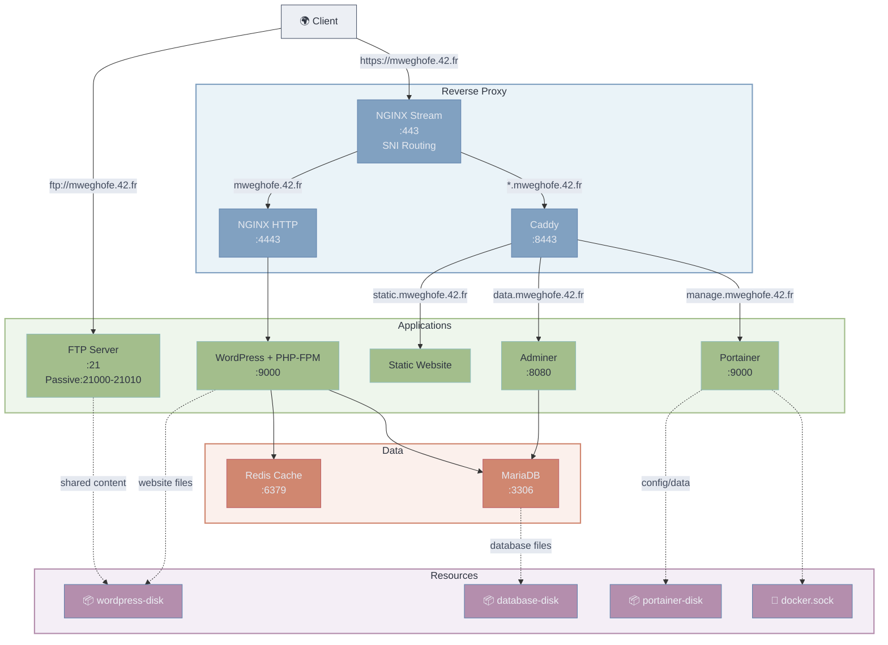

*This project has been created as part of the 42 curriculum by mweghofe.*

# Inception

## Description

Inception is a small production-like infrastructure, built from scratch with Docker Compose as part of 42's system administration curriculum. Every image is built from a custom Dockerfile (no pre-built images besides the Alpine base) and orchestrated as a set of single-purpose containers on a private Docker network.

The mandatory stack serves a WordPress website (WordPress + php-fpm, MariaDB, NGINX with TLS) reachable at `https://mweghofe.42.fr`. The bonus part extends it with a Redis object cache, an FTP server, a static showcase website, Adminer, and Portainer — plus a personal addition: **Caddy as a second reverse-proxy layer**, so bonus services live on their own subdomains behind their own TLS termination rather than being bolted onto the NGINX config.

### Architecture



Only port **443** is ever exposed to the outside for HTTP(S) traffic (plus 21/21000-21010 for the FTP bonus). NGINX's `stream` module reads the TLS *ClientHello* SNI field without terminating TLS, and routes purely on hostname: the bare domain goes to NGINX's HTTP server (WordPress), any subdomain goes to Caddy, and anything else is dropped by a black-hole `server` block. Caddy then terminates TLS a second time and reverse-proxies each subdomain to its bonus service. For the full breakdown of every service and container, see [DEV_DOC.md § Service Architecture](DEV_DOC.md#service-architecture).

### Main design choices

- **Alpine 3.23** (penultimate stable) as the base image for every container — small footprint, `apk` covers every package needed.
- **Two-layer reverse proxy**: NGINX `stream` for SNI-only routing, then NGINX *or* Caddy for TLS termination depending on the domain. This was chosen over cramming every bonus service into NGINX server blocks, to keep the mandatory and bonus configs fully independent.
- **Docker secrets** for every credential; **`.env`** for everything else (domain, usernames, ports) — see the comparison table below.
- **WP-CLI**, run from the entrypoint, for a fully headless WordPress install (no setup wizard).
- **Idempotent entrypoints**: each service checks for a sentinel (`.init_completed`, `wp-config.php`, an existing OS user, ...) so containers can be freely restarted or rebuilt without repeating first-run setup.

### Technology comparisons

#### Virtual Machines vs Docker

| Aspect | Virtual Machine | Docker |
|---|---|---|
| Isolation | Full guest OS via a hypervisor | Shared host kernel, isolated userland (namespaces/cgroups) |
| Startup time | Minutes (full boot) | Seconds (process launch) |
| Image size | Gigabytes | Megabytes |
| Overhead | Hypervisor + guest OS | Minimal |
| Best suited for | Running different/untrusted OSes | Packaging & isolating many small, cooperating services |

The whole stack still runs *inside* one VM, since that boundary is required by the subject — but each individual service is a container, not its own VM. Container-level isolation is all that's needed between cooperating services on one host, without paying for a full guest OS per service.

#### Secrets vs Environment Variables

| Aspect | Docker Secrets | Environment Variables (`.env`) |
|---|---|---|
| Storage | Mounted as files under `/run/secrets/*`, inside the container only | Key-value pairs baked into the container's environment |
| Visibility | Hidden from `docker inspect`, `ps`, and `docker-compose.yml` | Visible via `docker inspect`/`ps`, easy to leak into logs |
| Best suited for | Passwords, API keys, anything confidential | Non-sensitive configuration |

Every credential in this project — MariaDB, WordPress, FTP, Portainer — is a Docker secret; `.env` holds only non-sensitive configuration (domain name, usernames, ports, paths).

#### Docker Network vs Host Network

| Aspect | Docker Network (bridge) | Host Network |
|---|---|---|
| Isolation | Each container gets its own network namespace | Container shares the host's network stack directly |
| Port exposure | Explicit, via `ports:`/`expose:` | Every port is exposed automatically |
| Service discovery | Built-in DNS by container name | Manual, via `localhost` + distinct ports |
| Allowed by the subject | Yes | No — `network: host`/`--link` are forbidden |

The stack runs on a dedicated bridge network (`inception_network`). Only NGINX (443) and FTP (21, 21000-21010) publish ports to the host; every other service stays internal and is reached by the other containers via Docker's built-in DNS.

#### Docker Volumes vs Bind Mounts

| Aspect | Named Volumes | Bind Mounts |
|---|---|---|
| Tracked by Docker | Yes (`docker volume ls`) | No |
| Host path | Chosen by Docker, unless pinned via `driver_opts` | Specified explicitly, must already exist |
| Portability | Consistent across hosts | Tied to that host's filesystem layout |
| Allowed by the subject | Yes (required) | No — explicitly forbidden |

This project needs a volume that Docker tracks as a named volume, but whose data still lands at a specific, known host path — so it uses the `local` driver with `type: none, o: bind`: a named volume in every way Docker (and the subject) cares about, backed by a bind mount under `./data/`. See [DEV_DOC.md § Named volumes](DEV_DOC.md#named-volumes-bind-mount-backend) for the exact configuration.

## Instructions

### Prerequisites

- A Linux virtual machine (the subject requires the whole stack to run inside one)
- Docker Engine with the Compose v2 plugin, and `make`
- The domain `mweghofe.42.fr` (and its subdomains) resolving to the VM's IP — e.g. via `/etc/hosts` on the client machine

### Setup & run

```bash
git clone <repository_url> && cd Inception
# create the six required secret files — see USER_DOC.md#creating-the-secrets
make
```

Then open `https://mweghofe.42.fr` in a browser (self-signed certificate, expect a warning). See [USER_DOC.md](USER_DOC.md) for every service URL, default users, and how to verify everything is healthy; see [DEV_DOC.md](DEV_DOC.md) for the full `make`/`docker compose` command reference, the `.env` layout, and how project data persists on disk.

| Command | Effect |
|---|---|
| `make` | Build every image and start the whole stack (detached) |
| `make down` | Stop containers, keep volumes and images |
| `make clean` / `make fclean` | Full teardown — see [DEV_DOC.md § Managing Containers and Volumes](DEV_DOC.md#managing-containers-and-volumes) |

## Resources

### Documentation & references

- [Docker documentation](https://docs.docker.com/) & [Compose file reference](https://docs.docker.com/compose/compose-file/)
- [NGINX stream module (`ssl_preread`)](https://nginx.org/en/docs/stream/ngx_stream_ssl_preread_module.html)
- [WP-CLI command reference](https://wp-cli.org/commands/)
- [MariaDB Knowledge Base](https://mariadb.com/kb/) — secure installation, user privileges
- [Redis configuration reference](https://redis.io/docs/management/configuration/)
- [Pure-FTPd documentation](https://www.pureftpd.org/project/pure-ftpd/doc/)
- [Caddy documentation](https://caddyserver.com/docs/) — Caddyfile, automatic TLS
- [Portainer CLI reference](https://docs.portainer.io/advanced/cli)
- [Alpine Linux packages](https://pkgs.alpinelinux.org/packages)

### AI usage

AI assistants were used throughout this project as a learning and productivity aid: explaining Docker, Compose, and Linux service concepts while the stack was being designed; reviewing the finished implementation against the subject's requirements; helping debug specific issues in entrypoint scripts and configuration files; and drafting this documentation (`README.md`, `USER_DOC.md`, `DEV_DOC.md`) based on the finished project, which was then reviewed and adjusted by hand.
