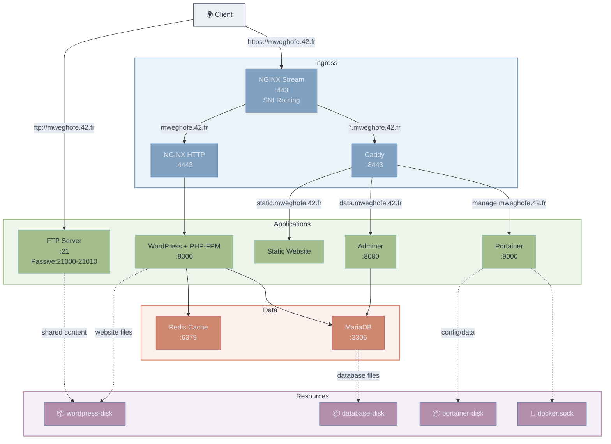

*This project has been created as part of the 42 curriculum by mweghofe.*


# Inception

## Description

Inception is a Docker Compose project that sets up a complete web infrastructure with WordPress, MariaDB, and NGINX as a reverse proxy. The project demonstrates containerization, networking, volume management, and security best practices using Docker.

### Architecture Overview



The project uses **Docker Compose** to orchestrate multiple containers on a custom bridge network (`inception_network`). All services are built from Alpine 3.23 images with custom Dockerfiles. The infrastructure uses **Docker secrets** for sensitive data and **named volumes** with bind mounts for persistence.

### Sources

- **NGINX**: Reverse proxy with TLS 1.2/1.3 and SNI-based stream routing
- **WordPress + php-fpm**: Application server without nginx
- **MariaDB**: Database server with secure installation
- **Redis**: Object cache for WordPress performance (bonus)
- **FTP**: Pure-FTPd server for file management (bonus)
- **Adminer**: Database management UI (bonus)
- **Portainer**: Container management UI (bonus)
- **Caddy**: Second-layer reverse proxy for subdomains (bonus)
- **Static Website**: Showcase site served by Caddy (bonus)

### Main Design Choices

- **Alpine 3.23**: Lightweight, secure base image (penultimate stable version)
- **Custom bridge network**: Isolates containers while enabling inter-service communication
- **Docker secrets**: Secure handling of credentials, passwords, and API keys
- **Named volumes**: Persistent storage for database, WordPress files, and Portainer data
- **Two-layer proxy**: NGINX stream for SNI routing + NGINX HTTP/Caddy for TLS termination

### Technology Comparisons

| Aspect | Option A | Option B | Why We Chose A |
|--------|----------|----------|----------------|
| **Virtualization** | Virtual Machines | Docker Containers | Containers are lightweight, fast to start, and share the host OS kernel. VMs require full OS instances, consuming more resources. Docker provides process isolation with minimal overhead. |
| **Secrets Management** | Docker Secrets | Environment Variables | Docker secrets are encrypted at rest, mounted as tmpfs in memory, and never written to disk. Environment variables can be exposed in logs or process listings. Secrets provide superior security for sensitive data. |
| **Networking** | Docker Network (bridge) | Host Network | Bridge networks provide isolation between containers, better security, and explicit control over connectivity. Host networking exposes ports directly on the host, bypassing Docker's networking stack but losing isolation. |
| **Persistent Storage** | Docker Volumes | Bind Mounts | While we use bind mounts (`type: none, o: bind`) for the volume backend, Docker volumes provide better abstraction and portability. They're managed by Docker and can be easily backed up or migrated. |

## Instructions

### Prerequisites

- Virtual Machine (required by 42 curriculum)
- Docker (v20 or higher)
- Docker Compose (v2 or higher)
- Git
- Minimum 4GB RAM recommended

### Quick Start

```bash
# Clone the project
git clone <repository-url>
cd Inception

# Build images and start all containers
make

# Access the main WordPress site
https://mweghofe.42.fr
```

### Management Commands

| Command | Description |
|---------|-------------|
| `make` | Build and start all containers |
| `make down` | Stop and remove containers (keeps volumes) |
| `make clean` | Remove containers, networks, and volumes |
| `make fclean` | Full cleanup including images |
| `make re` | Rebuild everything from scratch |
| `make logs` | Follow logs from all containers |
| `make sh <service>` | Shell into a running container |
| `make ps` | Show running services |
| `make du` | Show Docker disk usage |

## Resources

### Documentation & Tutorials

- [Docker Official Documentation](https://docs.docker.com/)
- [Docker Compose Documentation](https://docs.docker.com/compose/)
- [NGINX Documentation](https://nginx.org/en/docs/)
- [WordPress Docker Image](https://hub.docker.com/_/wordpress)
- [MariaDB Docker Image](https://hub.docker.com/_/mariadb)
- [Caddy Documentation](https://caddyserver.com/docs/)
- [Redis Documentation](https://redis.io/docs/)

### AI Usage

This project was developed with assistance from AI models:

- **Claude** wrote detailed study material explaining Docker fundamentals, how each service functions, and how they interact within the infrastructure.
- **Various models** assisted with debugging tasks and answered specific technical questions during development.
- **All documentation** (README.md, USER_DOC.md, DEV_DOC.md) was written by AI models based on the project requirements and implementation.
