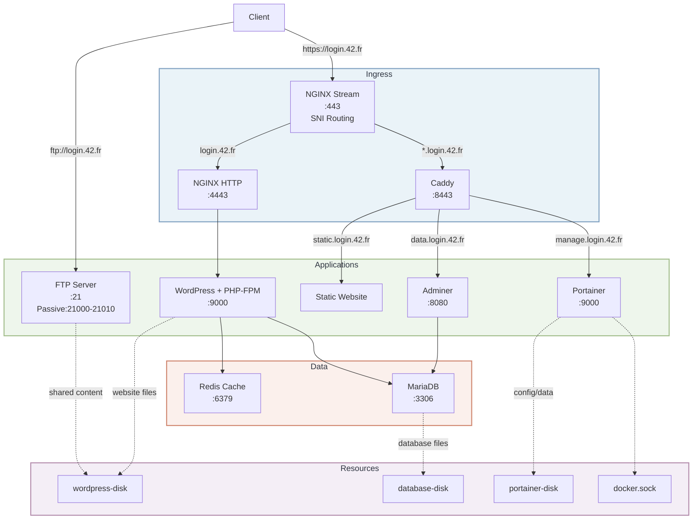

*This project has been created as part of the 42 curriculum by mweghofe.*

# Inception

## Description

Inception is a system administration project that virtualizes a multi-service infrastructure using Docker Compose. The goal is to build a small production-like stack from scratch — writing every Dockerfile, configuring every service, and orchestrating them with Docker Compose — all running inside a single virtual machine.

The project delivers a WordPress website backed by MariaDB, fronted by NGINX with TLS termination, and extended with bonus services: Redis cache, FTP access, a static HTML site, Adminer for database management, and Portainer for container administration.

### Main Design Choices

- **Alpine 3.23** as the base image for all containers (lightweight, penultimate stable release)
- **Two-layer reverse proxy**: NGINX stream module reads SNI without terminating TLS, routing traffic to either NGINX (WordPress) or Caddy (bonus services) based on the subdomain
- **Docker secrets** for all credentials — never hardcoded in images or environment variables
- **WP-CLI** for headless WordPress installation and configuration
- **Entrypoint scripts** with `exec` to respect PID 1 and proper signal handling

### Architecture



### Technology Comparisons

#### Virtual Machines vs Docker

| Aspect | Virtual Machines | Docker |
|---|---|---|
| **Isolation** | Full OS per VM via hypervisor | Shared kernel, isolated userland |
| **Startup** | Minutes (full boot) | Seconds (process launch) |
| **Size** | GBs per image | MBs per image |
| **Overhead** | Hypervisor + guest OS | Minimal (namespaces, cgroups) |
| **Use case** | Running different OSes | Packaging applications consistently |

Docker was chosen for this project because the infrastructure uses a single Linux host where container-level isolation is sufficient. Each service runs in its own container with its own filesystem, network, and process space — without the overhead of a full virtual machine.

#### Secrets vs Environment Variables

| Aspect | Secrets | Environment Variables |
|---|---|---|
| **Storage** | Separate files, mounted at `/run/secrets/` | Key-value pairs in container env |
| **Visibility** | Only visible inside the container | Visible in `docker inspect`, compose file |
| **Security** | Not baked into images, not in process listing by default | Can leak in logs, ps output |
| **Use case** | Passwords, API keys, tokens | Configuration: domain names, ports, paths |

Environment variables are used for non-sensitive configuration (`DOMAIN_NAME`, `WP_TITLE`, etc.). Docker secrets are used for all credentials (`mysql`, `wp_db`, `wp_admin`, `wp_user`, `ftp`, `portainer`). This separation ensures no password is ever present in a Dockerfile, compose file, or image layer.

#### Docker Network vs Host Network

| Aspect | Docker Network (bridge) | Host Network |
|---|---|---|
| **Isolation** | Each container gets its own network namespace | Container shares host's network stack |
| **Port mapping** | Requires explicit `ports:` to expose | All ports directly accessible |
| **DNS** | Built-in service discovery by container name | Must use localhost with different ports |
| **Security** | Containers are isolated from each other by default | No network isolation |

The bridge network `inception_network` is used. Container-to-container communication uses Docker's internal DNS (e.g., `inception_mariadb:3306`). Only NGINX exposes port 443 to the host — all other services communicate internally via `expose`.

#### Docker Volumes vs Bind Mounts

| Aspect | Named Volumes | Bind Mounts |
|---|---|---|
| **Management** | Docker manages the storage location | Host path specified explicitly |
| **Portability** | Same across any Docker host | Path must exist on the host |
| **Performance** | Native Docker driver | Direct host filesystem access |
| **Backup** | `docker volume` commands | Standard file copy |
| **Use case** | Persistent data managed by Docker | Development, host integration |

This project uses named volumes with a local driver backend (`type: none, o: bind`). This hybrid approach creates volumes tracked by Docker (`docker volume ls`) while persisting data at a known host path (`./data/`). This is required because the subject mandates named volumes but also specifies data must reside at `/home/login/data`.

## Instructions

### Prerequisites

- Docker Engine with Docker Compose v2
- A Linux VM (the project must be run in a virtual machine)
- `make` installed
- Domain `login.42.fr` pointing to the VM's IP address (add to `/etc/hosts`)

### Setup

1. Clone the repository:
   ```bash
   git clone <repository_url> && cd Inception
   ```

2. Create the Docker secrets:
   ```bash
   mkdir -p secrets
   echo "your_mysql_password" > secrets/mysql.txt
   echo "your_wp_db_password" > secrets/wp_db.txt
   echo "your_wp_admin_password" > secrets/wp_admin.txt
   echo "your_wp_user_password" > secrets/wp_user.txt
   echo "your_ftp_password" > secrets/ftp.txt
   echo "your_portainer_password" > secrets/portainer.txt
   ```

3. Configure the domain in `srcs/.env`:
   ```
   DOMAIN_NAME=login.42.fr
   ```
   Replace `login` with your actual 42 login.

4. Build and start:
   ```bash
   make
   ```

### Available Commands

| Command | Description |
|---|---|
| `make` | Build images and start all containers |
| `make down` | Stop containers, keep volumes |
| `make clean` | Remove containers, volumes, prune cache |
| `make fclean` | Remove everything including images |
| `make re` | Full rebuild |
| `make sh <service>` | Shell into a running container |
| `make logs` | Follow logs from all containers |
| `make ps` | Show running services |
| `make <service>` | Start a specific service |

### Services

| Service | Port | Access |
|---|---|---|
| NGINX (WordPress) | 443 | `https://login.42.fr` |
| Static Site | 8443 | `https://static.login.42.fr` |
| Adminer | 8080 | `https://data.login.42.fr` |
| Portainer | 9000 | `https://manage.login.42.fr` |
| FTP | 21 | `ftp://login.42.fr` |

## Resources

### References

- [Docker Documentation](https://docs.docker.com/)
- [Docker Compose Specification](https://docs.docker.com/compose/compose-file/)
- [NGINX Stream Module](https://nginx.org/en/docs/stream/ngx_stream_ssl_preread_module.html)
- [WordPress Getting Started](https://wordpress.org/support/article/getting-started-with-wordpress/)
- [WP-CLI Commands](https://wp-cli.org/commands/)
- [MariaDB Knowledge Base](https://mariadb.com/kb/)
- [Redis Configuration](https://redis.io/docs/management/configuration/)
- [Pure-FTPd Documentation](https://www.pureftpd.org/)
- [Caddy Caddyfile](https://caddyserver.com/docs/caddyfile)
- [Adminer](https://www.adminer.org/)
- [Portainer Documentation](https://docs.portainer.io/)

### AI Usage

This project was developed with assistance from AI models:

- **Claude** wrote detailed study material explaining Docker fundamentals, how each service functions, and how they interact within the infrastructure.
- **Various models** assisted with debugging tasks and answered specific technical questions during development.
- **All documentation** (README.md, USER_DOC.md, DEV_DOC.md) was written by AI models based on the project requirements and implementation.
